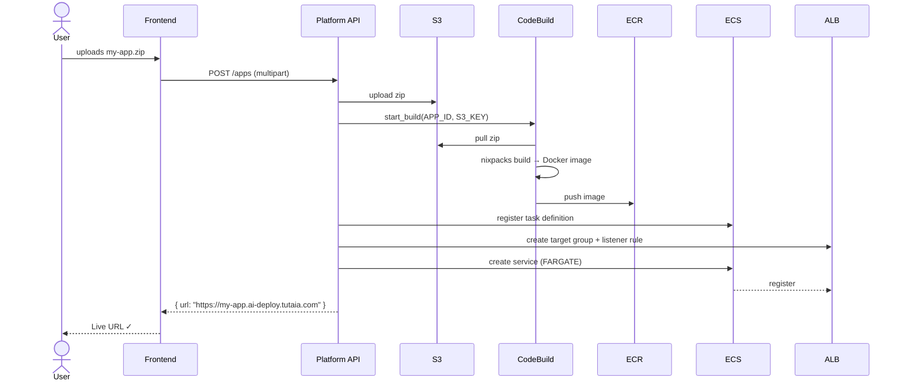

<div align="center">


# DeployFast &nbsp;·&nbsp; by Tutaia

**Deploy your vibe-coded app in 60 seconds.**

[](https://deployfast.tutaia.com)
[](LICENSE)
[](https://www.terraform.io)
[](https://aws.amazon.com)
[](tutaia-web/)
[](tutaia-api/)

<br/>

[🚀 Try it live](https://deployfast.tutaia.com) &nbsp;·&nbsp;
[📖 How it works](#how-it-works) &nbsp;·&nbsp;
[💰 Pricing](#pricing) &nbsp;·&nbsp;
[🛠 Local dev](#local-development) &nbsp;·&nbsp;
[☁️ Infrastructure](INFRASTRUCTURE.md)

</div>

---

## The Problem

You just built something with an AI coding tool. It runs perfectly on `localhost`. But sharing it means:

| The painful way | With DeployFast |
|---|---|
| Learn Docker from scratch | Zip your folder |
| Configure a CI/CD pipeline | Drag & drop upload |
| Buy and set up a server | Hit **Deploy** |
| Debug environment variables for hours | Get a live HTTPS URL |

Most vibe-coded apps never leave `localhost:5000`. **DeployFast fixes that.**

---

## How It Works


<details>
<summary><strong>Step 1 — Prepare</strong> &nbsp;✅</summary>

Run the DeployFast pre-deploy checklist prompt inside your AI coding tool (Cursor, Windsurf, Claude, etc.).

It verifies:
- Your app binds to the correct port (`8080` or respects the `PORT` env var)
- A `requirements.txt`, `package.json`, or equivalent dependency file exists
- No hardcoded `localhost` or `127.0.0.1` URLs in your code

</details>

<details>
<summary><strong>Step 2 — Upload</strong> &nbsp;📤</summary>

Zip your project folder. Drag it onto the DeployFast dashboard, give your app a name, and hit **Deploy**.

Supported zip structures:
```
my-app.zip
├── app.py          ← flat layout ✓
└── requirements.txt

my-app.zip
└── my-app/
    ├── app.py      ← single subfolder ✓ (auto-flattened)
    └── requirements.txt
```

</details>

<details>
<summary><strong>Step 3 — Ship</strong> &nbsp;🚀</summary>

DeployFast auto-detects your stack with [Nixpacks](https://nixpacks.com), builds a Docker image, and deploys it to AWS ECS Fargate. You get a live HTTPS URL — no config files, no Dockerfile, no DevOps knowledge required.

</details>

---

## Supported Stacks

> Auto-detected by Nixpacks — no `Dockerfile` or config needed.

<details>
<summary>View all supported stacks</summary>

| Language / Framework | Detection signal | Notes |
|---|---|---|
| **Python** — Flask, FastAPI, Django, Streamlit, Gradio | `requirements.txt` / `pyproject.toml` | Binds to `$PORT` |
| **Node.js** — Express, Next.js, Remix, Fastify | `package.json` | `npm start` or `node index.js` |
| **Static HTML** | `index.html` at root | Served via nginx |
| **Go** | `go.mod` | Binary compiled, then run |
| **Ruby** | `Gemfile` | Rack / Rails supported |
| **PHP** | `composer.json` / `index.php` | Apache-served |
| **Rust** | `Cargo.toml` | Binary compiled |

Any other [Nixpacks-supported](https://nixpacks.com/docs/providers) runtime works too.

</details>

---

## Pricing

<table>
<tr>
<td width="50%" align="center">

### Starter
**$29 / month**

`1 app`

- Live HTTPS URL
- Auto-deployment on re-upload
- Infinite re-deployments
- 100% money-back guarantee

[Get Started →](https://deployfast.tutaia.com/pricing)

</td>
<td width="50%" align="center">

### ⭐ Builder &nbsp;<sup>Most Popular</sup>
**$39 / month**

`2 apps`

- Live HTTPS URL
- Auto-deployment on re-upload
- Infinite re-deployments
- 100% money-back guarantee

[Get Started →](https://deployfast.tutaia.com/pricing)

</td>
</tr>
</table>

> No annual lock-in. Cancel any time.

---

## Tech Stack

<details>
<summary><strong>Frontend</strong> — <code>tutaia-web/</code> (React + Vite + Tailwind)</summary>

| Technology | Role |
|---|---|
| React 18 + TypeScript | UI framework |
| Vite | Build tool & dev server |
| Tailwind CSS | Utility-first styling |
| Clerk | Authentication — sign-up / sign-in / JWT |
| Stripe.js | Subscription checkout flow |
| React Router v6 | Client-side routing |

**Pages**

| Route | Page |
|---|---|
| `/` | Landing |
| `/pricing` | Pricing & checkout |
| `/sign-in` | Sign in (Clerk) |
| `/sign-up` | Sign up (Clerk) |
| `/prepare` | Pre-deploy checklist |
| `/deploy` | Upload & deploy |
| `/dashboard` | Manage running apps |
| `/payment-success` | Post-checkout confirmation |

</details>

<details>
<summary><strong>Backend API</strong> — <code>tutaia-api/</code> (Python + FastAPI)</summary>

| Technology | Role |
|---|---|
| Python 3.11 + FastAPI | REST API |
| SQLAlchemy | ORM |
| PostgreSQL (AWS RDS) | Platform database |
| Clerk JWT middleware | Request authentication |
| Stripe API | Subscription management |
| boto3 (AWS SDK) | Orchestrate ECS / CodeBuild / ECR / S3 |

**API Routes**

| Router | Endpoints |
|---|---|
| `auth.py` | `POST /auth/verify` |
| `apps.py` | `GET/POST /apps` · `DELETE /apps/{id}` · `GET /apps/{id}/status` |
| `payments.py` | `POST /payments/checkout` · `GET /payments/subscription` · `POST /payments/webhook` |
| `health.py` | `GET /health` |

</details>

<details>
<summary><strong>Infrastructure</strong> — Terraform on AWS</summary>

| AWS Service | Role |
|---|---|
| ECS Fargate | Run containerised user apps + platform API |
| CodeBuild + Nixpacks | Auto-build Docker images from uploaded zips |
| ECR | Store Docker images |
| ALB | Route subdomain traffic to the right container |
| S3 | Uploaded zip storage + static frontend hosting |
| CloudFront | CDN for the React frontend |
| RDS PostgreSQL | Platform metadata database |
| Route 53 + ACM | DNS + wildcard `*.ai-deploy.tutaia.com` HTTPS |
| SSM Parameter Store | Runtime secrets (DB URL, API keys) |

Full setup guide → [INFRASTRUCTURE.md](INFRASTRUCTURE.md)

</details>

---

## Repository Structure

```
tutaia-infra/
│
├── 📄 README.md
├── 📄 INFRASTRUCTURE.md          # Terraform setup guide
│
├── ☁️  *.tf                       # Terraform root module (AWS infra)
├── 📄 terraform.tfvars.example   # Variable defaults — copy → terraform.tfvars
│
├── 🐍 tutaia-api/                 # Platform API (Python / FastAPI)
│   ├── app/
│   │   ├── routers/              # apps · auth · payments · health
│   │   ├── services/             # deployment · aws · preflight
│   │   ├── models/               # SQLAlchemy ORM models
│   │   ├── schemas/              # Pydantic request / response schemas
│   │   └── main.py
│   └── Dockerfile
│
└── ⚛️  tutaia-web/                 # Frontend (React / Vite / Tailwind)
    ├── src/
    │   ├── pages/                # Landing · Pricing · Deploy · Dashboard …
    │   ├── components/           # Navbar · FileUpload · StatusBadge …
    │   └── api.ts                # Typed API client
    └── vite.config.ts
```

---

## Local Development

### Prerequisites

- Node.js 18+
- Python 3.11+
- AWS credentials configured (`aws configure`)

### Frontend

```bash
cd tutaia-web
cp .env.example .env        # set VITE_CLERK_PUBLISHABLE_KEY + VITE_API_URL
npm install
npm run dev                 # → http://localhost:5173
```

### Backend API

```bash
cd tutaia-api
python -m venv .venv && source .venv/bin/activate
pip install -r requirements.txt
cp .env.example .env        # set DATABASE_URL, CLERK_SECRET_KEY, STRIPE_SECRET_KEY, AWS vars
uvicorn app.main:app --reload   # → http://localhost:8000
```

### Infrastructure

See [INFRASTRUCTURE.md](INFRASTRUCTURE.md) for the full Terraform guide (`terraform init` → `plan` → `apply`).

---

## Under the Hood — Deployment Flow



---

## Security

<details>
<summary>View security model</summary>

| Area | Approach |
|---|---|
| **Isolation** | Each user app runs in its own ECS Fargate task — separate container, no shared filesystem |
| **Uploaded files** | Zips auto-deleted from S3 after 24 hours; only the built Docker image persists |
| **TLS** | All traffic encrypted via a wildcard ACM certificate (`*.ai-deploy.tutaia.com`) |
| **Secrets** | Stored in AWS SSM Parameter Store as `SecureString`; injected at container launch — never baked into images |
| **Auth** | Clerk issues JWTs; the platform API validates every request before acting |
| **Database** | RDS is in private subnets with no public accessibility |
| **S3** | Uploads bucket has all public access blocked |

</details>

---

## Status

> **Public Beta** — Python and Node.js apps are fully supported.  
> More stacks and features are being added based on user feedback.

---

## License

[MIT](LICENSE)

---

<div align="center">
  <sub>Built with ❤️ and deployed on DeployFast &nbsp;·&nbsp; <a href="https://deployfast.tutaia.com">deployfast.tutaia.com</a></sub>
</div>
